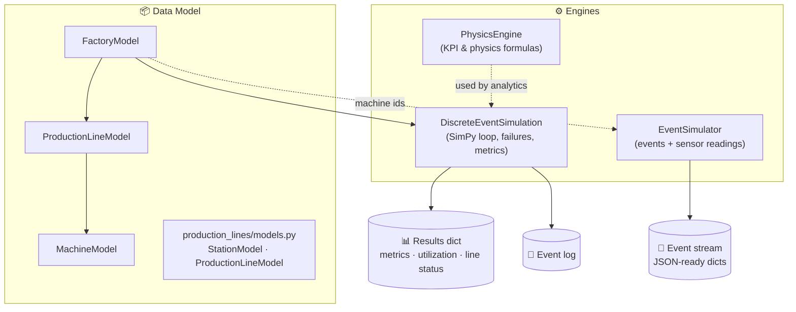
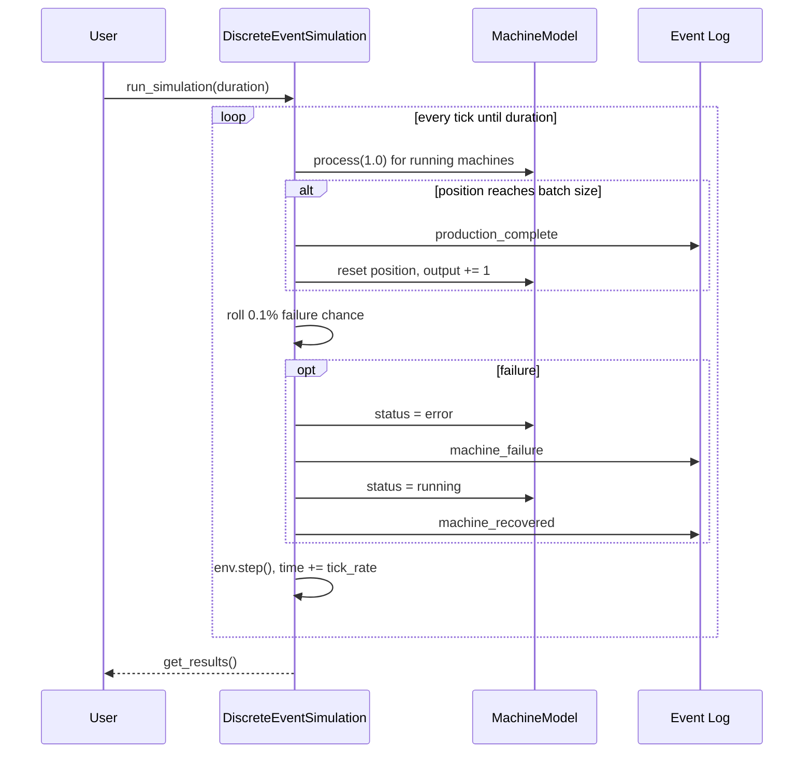

<div align="center">

# 🏭 Simulation Engine

### A lightweight Digital Twin toolkit for factory & production-line simulation

*Model machines. Stream sensor data. Inject failures. Find bottlenecks, all in pure Python.*


</div>

---

## 📖 Table of Contents

1. [Overview](#-overview)
2. [Key Features](#-key-features)
3. [Architecture](#-architecture)
4. [Project Structure](#-project-structure)
5. [Module Reference](#-module-reference)
6. [Installation](#-installation)
7. [Quick Start](#-quick-start)
8. [How the Simulation Works](#-how-the-simulation-works)
9. [Formulas & Models](#-formulas--models)
10. [Known Limitations & Roadmap](#-known-limitations--roadmap)
11. [Contributing](#-contributing)
12. [Author](#-author)

---

## 🔎 Overview

**Simulation Engine** is a modular Python toolkit for building a **virtual replica (digital twin) of a manufacturing plant**. It lets you describe a factory as a hierarchy of *Factory → Production Lines → Machines*, then:

- run a **discrete-event simulation** (powered by [SimPy](https://simpy.readthedocs.io/)) with random machine failures,
- generate **realistic IoT-style event streams and sensor readings** (temperature, vibration, pressure, speed, energy),
- compute **industrial KPIs** such as efficiency, utilization, queue delay, energy use and bottlenecks.

It is designed as the **simulation backbone** for industrial analytics, predictive-maintenance prototypes, and ML pipelines that need synthetic factory data *without* needing real machines.

---

## ✨ Key Features

| Feature | Description |
|---|---|
| 🧱 **Hierarchical factory model** | `FactoryModel` → `ProductionLineModel` → `MachineModel`, built with clean `@dataclass`es |
| ⏱️ **Discrete-event engine** | SimPy-backed loop with tick-based machine processing and an event log |
| 💥 **Failure injection** | Random machine failures (0.1 % per tick) with recovery events and downtime metrics |
| 📡 **Synthetic sensor streams** | 5 sensor types per machine with realistic value ranges, units and quality flags |
| 🧮 **Physics / KPI toolkit** | 8 stateless static helpers: efficiency, utilization, queue delay, energy, bottleneck… |
| ❤️ **Machine health score** | Weighted score combining baseline, wear and efficiency |
| 🧭 **Line optimizer** | Station-level capacity model with a layout-sorting helper |
| 🔌 **Dependency-light** | Only `simpy` is required; everything else is standard library |

---

## 🏗️ Architecture



**Design principle:** *models hold state, engines drive behaviour, the physics module is pure functions.* This keeps each file independently testable and easy to swap out.

---

## 📁 Project Structure

```
Simulation-engine/
├── discrete_event_simulation.py   # SimPy-based simulation loop, failures, metrics
├── event_simulator.py             # Synthetic event & sensor-reading generator
├── factory_model.py               # Machine / Line / Factory dataclasses
├── physics_engine.py              # Stateless KPI & physics formulas
└── production_lines/
    └── models.py                  # Station-based production-line configuration
```

| File | Lines | Role |
|---|---:|---|
| `factory_model.py` | 103 | Core domain model (state + per-step behaviour) |
| `discrete_event_simulation.py` | 117 | Orchestrates the simulation and logs events |
| `event_simulator.py` | 97 | Produces data streams for dashboards / ML |
| `physics_engine.py` | 65 | Reusable industrial formulas |
| `production_lines/models.py` | 54 | Alternative station-level line description |

---

## 🧩 Module Reference

### 1. `factory_model.py` — the domain model

Three nested dataclasses describe the plant.

#### `MachineModel`
| Field | Default | Meaning |
|---|---|---|
| `id`, `name`, `machine_type` | — | Identity of the machine |
| `status` | `'running'` | `running`, `error`, … |
| `utilization` | `0.0` | Percent (0–100) |
| `cycle_time` | `60.0` | Seconds per unit |
| `current_position` | `0.0` | Progress through the current batch |
| `last_update` | `utcnow()` | Timestamp of last change |

**Methods**
- `update_status(status)` — changes status and refreshes `last_update`.
- `process(duration) -> bool` — advances `current_position` by `duration / cycle_time` and updates utilization; returns `False` if the machine is not `running`.
- `get_health_score() -> float` — returns `0.5·100 + 0.3·wear_factor + 0.2·efficiency_factor`, where `wear_factor = max(0, 100 − position/10)` and `efficiency_factor = utilization`.

#### `ProductionLineModel`
Holds a list of machines plus `queue_length`, `throughput`, `status`.
- `add_machine(machine)`
- `calculate_throughput()` — units/minute derived from the cycle times of **running** machines (`60 / cycle_time`); returns `0` if nothing is running.
- `simulate_step(time_step)` — processes every running machine, drains the queue, refreshes throughput.

#### `FactoryModel`
Top-level container with `production_lines`, `total_machines`, `overall_utilization`, `status`.
- `add_production_line(line)` — appends the line and recomputes `total_machines`.
- `calculate_overall_utilization()` — mean utilization across all machines.
- `simulate_step(time_step)` — steps every line, then sets status to `active` or `idle`.

---

### 2. `discrete_event_simulation.py` — the simulation engine

`DiscreteEventSimulation(factory_model)` wraps a **SimPy `Environment`** and a factory.

| Member | Purpose |
|---|---|
| `events_log` | List of event dicts (`type`, `timestamp`, `details`, `sequence_id`) |
| `metrics` | `total_events`, `machine_downtime`, `production_output` |
| `add_event(type, timestamp, details)` | Appends an event with an auto-incrementing sequence id |
| `run_simulation(duration, tick_rate=1.0)` | Main loop: process events → advance clock → repeat until `duration` |
| `_process_events(t)` | For every running machine: simulate work and roll for a failure |
| `_simulate_machine_operation(m, t)` | Processes one time unit; on batch completion logs `production_complete`, resets the machine and increments output |
| `_trigger_failure(m, t)` | Sets `error`, logs `machine_failure`, counts downtime, then logs `machine_recovered` |
| `get_results()` | Returns duration, event count, metrics copy, factory utilization and per-line status/throughput |

**Event types emitted:** `production_complete`, `machine_failure`, `machine_recovered`.

---

### 3. `event_simulator.py` — synthetic data generator

`EventSimulator` creates data that looks like it came from a real plant floor.

- **Event types:** `start`, `stop`, `maintenance`, `error`, `warning`, `complete`
- **Severity levels:** `info`, `warning`, `critical`

| Method | What it returns |
|---|---|
| `create_event(type, factory_id, machine_id, extra_data)` | One standardized event dict (`id`, `type`, `timestamp`, `severity`, `source='simulator'`, …) |
| `simulate_sensor_readings(factory_id, machine_ids)` | 5 readings per machine, with a `quality` flag (`good` 60 %, `fair` 20 %, `poor` 20 %) |
| `generate_event_stream(factory_id, machine_ids, events_per_second=100)` | `events_per_second // 2` random state-change events **plus** all sensor readings |

**Sensor ranges**

| Sensor | Range | Unit |
|---|---|---|
| temperature | 40 – 80 | °C |
| vibration | 0.1 – 5.0 | mm/s |
| pressure | 90 – 110 | bar |
| speed | 50 – 200 | RPM |
| energy | 10 – 50 | kWh |

---

### 4. `physics_engine.py` — KPI & physics toolkit

All methods are `@staticmethod`, so no instantiation is required.

| Method | Returns |
|---|---|
| `calculate_cycle_time(base_time, load_factor)` | Load-adjusted cycle time |
| `calculate_efficiency(actual, theoretical_max)` | Efficiency in % |
| `calculate_utilization(active, available)` | Utilization in % |
| `predict_downtime(consecutive_failures, avg_interval)` | Heuristic downtime estimate |
| `calculate_queue_delay(queue_size, service_rate)` | Expected wait (`inf` if rate ≤ 0) |
| `simulate_material_flow(inflow, outflow, capacity, period)` | Inventory level, starting at 50 % and clamped to `[0, capacity]` |
| `calculate_energy_consumption(power_rating, utilization, hours)` | Energy in kWh |
| `analyze_bottleneck(process_times)` | `(index_of_slowest, % above average)` |

---

### 5. `production_lines/models.py` — station-level line model

An alternative, finer-grained way to describe a line as a sequence of **stations**.

- **`StationModel`** — `id`, `name`, `station_type`, `processing_time`, `capacity`, `status`, `current_queue`; `process_item()` removes one item from the queue if the station is active.
- **`ProductionLineModel`** — holds stations and `total_capacity`.
  - `add_station(station)`
  - `calculate_theoretical_capacity()` — `min(capacity / processing_time)` across stations (the bottleneck rate).
  - `optimize_layout()` — sorts stations by processing time and returns the resulting capacity.

> 💡 Note: this `ProductionLineModel` is a *different class* from the one in `factory_model.py`. Import them with aliases if you use both.

---

## ⚙️ Installation

```bash
git clone https://github.com/010Ankushsharma/Simulation-engine.git
cd Simulation-engine

python -m venv .venv
source .venv/bin/activate        # Windows: .venv\Scripts\activate

pip install simpy
```

**Requirements:** Python 3.9+ and `simpy`.

---

## 🚀 Quick Start

### 1. Build a factory and step it forward

```python
from factory_model import FactoryModel, ProductionLineModel, MachineModel

factory = FactoryModel(id=1, name="Bangalore Plant")
line = ProductionLineModel(id=1, name="Assembly Line A")

for i, (name, cycle) in enumerate([("Cutter", 30), ("Welder", 60), ("Painter", 45)]):
    line.add_machine(MachineModel(id=i, name=name, machine_type="cnc", cycle_time=cycle))

factory.add_production_line(line)

factory.simulate_step(time_step=1.0)
print(f"Utilization: {factory.overall_utilization:.2f}%  |  Status: {factory.status}")
```

### 2. Generate a synthetic sensor & event stream

```python
from event_simulator import EventSimulator

sim = EventSimulator()
stream = sim.generate_event_stream(factory_id=1, machine_ids=[0, 1, 2], events_per_second=100)

print(len(stream), "records")      # 50 events + 15 sensor readings = 65
print(stream[-1])                  # a sensor reading dict
```

### 3. Use the physics toolkit

```python
from physics_engine import PhysicsEngine as PE

idx, impact = PE.analyze_bottleneck([30, 60, 45])
print(f"Bottleneck: process #{idx}, {impact:.1f}% above average")   # #1, 33.3%

print(PE.calculate_energy_consumption(power_rating=15, utilization=80, time_hours=8))  # 96.0 kWh
```

### 4. Station-level capacity analysis

```python
from production_lines.models import StationModel, ProductionLineModel as StationLine

line = StationLine(id=1, name="Packaging")
line.add_station(StationModel(1, "Fill", "filler", processing_time=10, capacity=2))
line.add_station(StationModel(2, "Seal", "sealer", processing_time=5,  capacity=1))

print(line.calculate_theoretical_capacity())   # 0.2 units / time-unit (bottleneck rate)
```

### 5. Run the discrete-event simulation

```python
from discrete_event_simulation import DiscreteEventSimulation

des = DiscreteEventSimulation(factory)
results = des.run_simulation(duration=3600)
```

> ⚠️ See **Known Limitations** #1 below. The SimPy clock needs a scheduled process before `run_simulation` can advance.

---

## 🔄 How the Simulation Works



**Returned results**

```python
{
  "simulation_duration": ...,
  "events_count": ...,
  "metrics": {"total_events": ..., "machine_downtime": ..., "production_output": ...},
  "factory_utilization": ...,
  "lines_status": [{"line_id": ..., "name": ..., "throughput": ..., "status": ...}]
}
```

---

## 📐 Formulas & Models

| Quantity | Formula |
|---|---|
| Cycle time under load | `base · (1 + (load − 1) · 0.5)` |
| Efficiency (%) | `actual / theoretical_max · 100` |
| Utilization (%) | `active_time / available_time · 100` |
| Queue delay | `queue_size / service_rate` |
| Predicted downtime | `consecutive_failures · avg_interval / 10` |
| Inventory | `clamp(0.5·capacity + (in − out)·t, 0, capacity)` |
| Energy (kWh) | `power · utilization/100 · hours` |
| Bottleneck impact (%) | `(max − mean) / mean · 100` |
| Health score | `0.5·100 + 0.3·wear + 0.2·efficiency` |
| Line capacity | `min(station.capacity / station.processing_time)` |

---

## 🧭 Known Limitations & Roadmap

Honest notes on the current state of the code, so contributors know where to help:

1. **`run_simulation` raises `simpy.core.EmptySchedule`.** `env.step()` is called while the SimPy event queue is empty. *Fix:* register machines as SimPy processes (generator functions that `yield env.timeout(...)`) and use `env.run(until=...)`.
2. **Recovery is instantaneous.** In `_trigger_failure`, `env.timeout(...)` is created but never `yield`ed, so the machine flips back to `running` immediately and downtime is only *counted*, not *simulated*.
3. **Line throughput uses the fastest machine.** `calculate_throughput` takes `min(cycle_time)`, but the docstring says "bottleneck". The bottleneck is `max(cycle_time)`.
4. **Batch-completion threshold.** `current_position` advances as a 0–1 fraction per unit but the batch check uses `>= 100`.
5. **Randomness is unseeded.** Add a `seed` parameter for reproducible runs.
6. **`datetime.utcnow()` is deprecated** in Python 3.12+; migrate to `datetime.now(timezone.utc)`.
7. **No tests or packaging yet.**

**Roadmap**
- [ ] Convert machines to true SimPy processes with resources and queues
- [ ] Wire `PhysicsEngine` into the simulation loop
- [ ] Unify the two `ProductionLineModel` classes
- [ ] Seedable RNG and configurable failure rates (MTBF / MTTR)
- [ ] `pytest` suite, `requirements.txt`, `pyproject.toml`
- [ ] Export results to CSV / JSON and a Streamlit dashboard
- [ ] Predictive-maintenance demo using the synthetic sensor stream

---

## 🤝 Contributing

1. Fork the repo
2. Create a branch: `git checkout -b feature/my-feature`
3. Commit: `git commit -m "Add my feature"`
4. Push: `git push origin feature/my-feature`
5. Open a Pull Request

---

## 👤 Author

**Ankush Sharma**, AI/ML Engineer
GitHub: [@010Ankushsharma](https://github.com/010Ankushsharma)

<div align="center">

⭐ *If you find this project useful, consider giving it a star!* ⭐

</div>